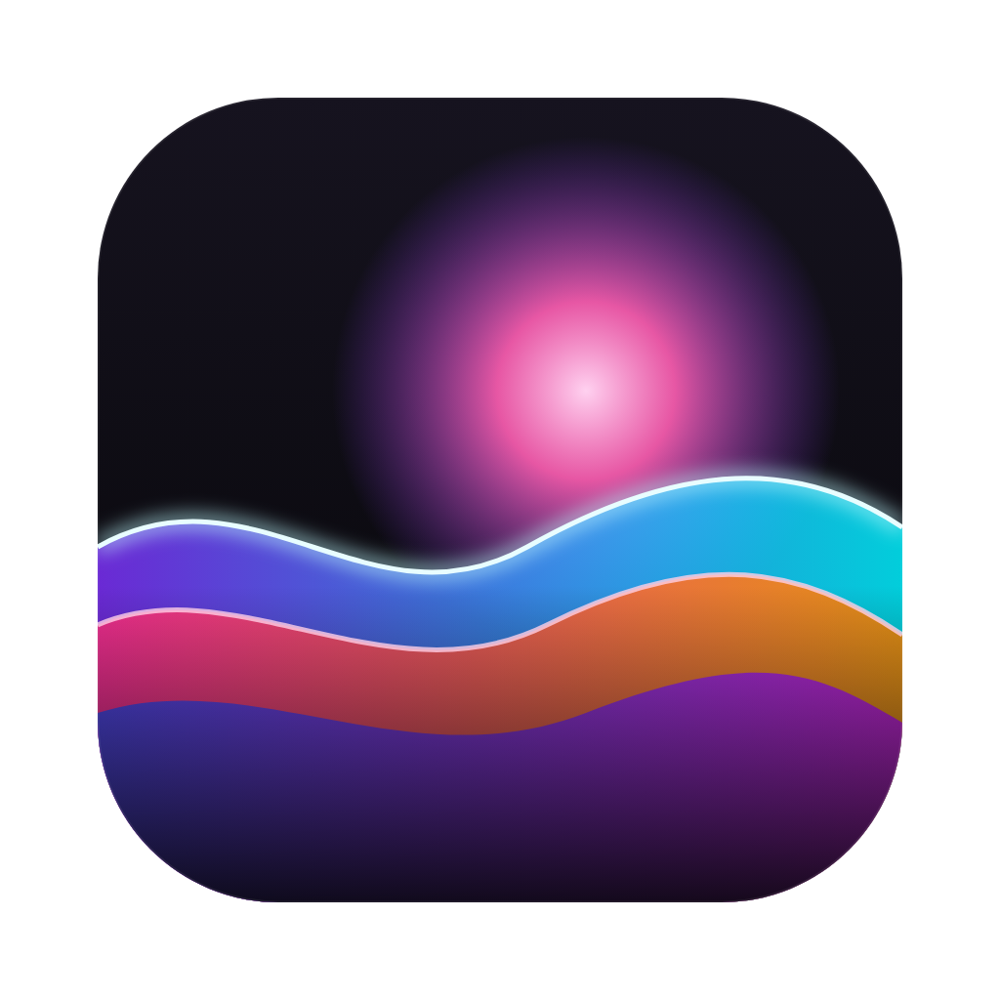
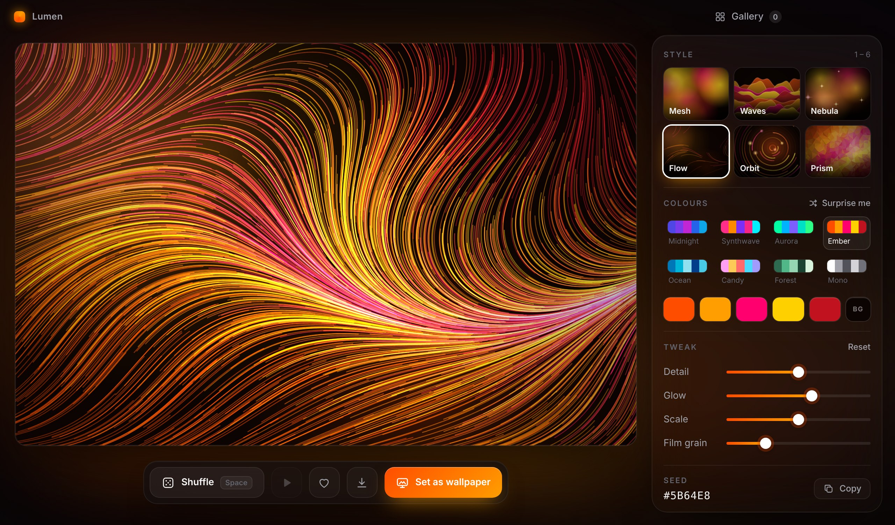
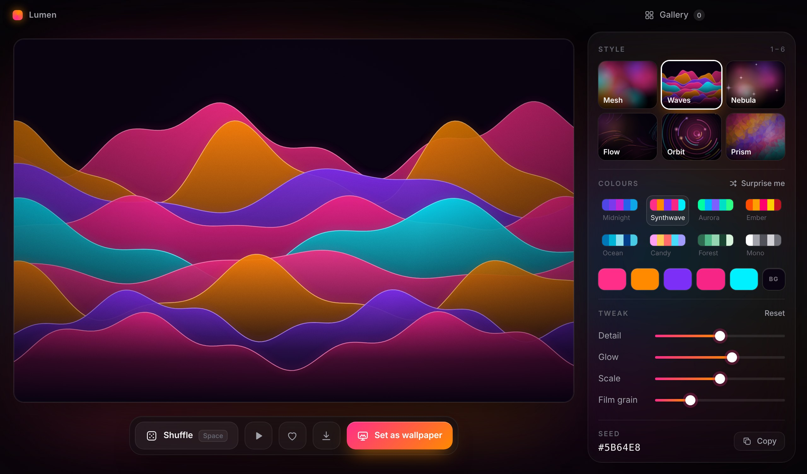
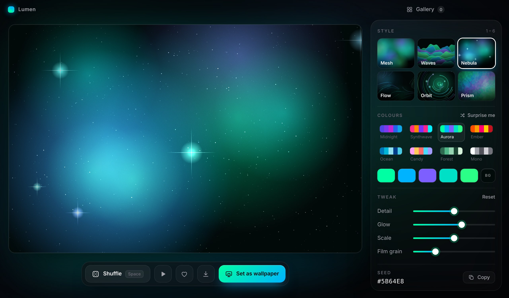
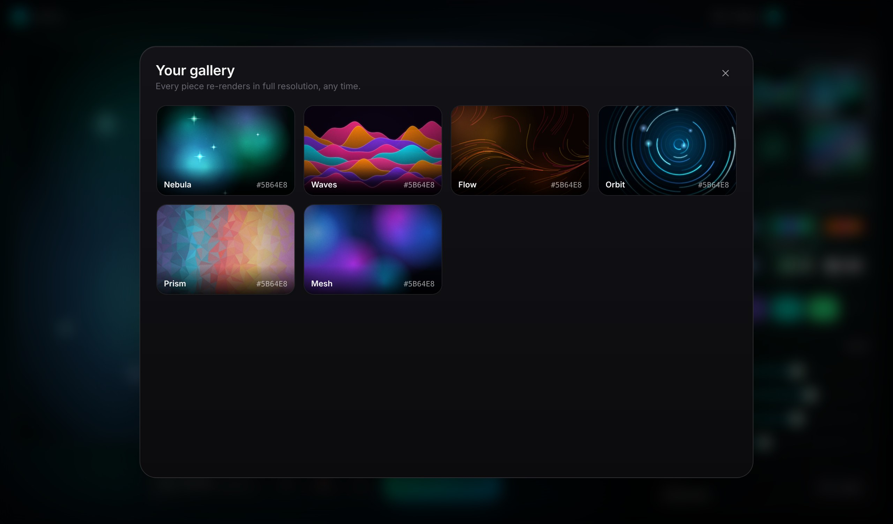

<p align="center">
  
</p>

<h1 align="center">Lumen</h1>

<p align="center">
  Make stunning, one-of-a-kind wallpapers, then set them in one click.<br/>
  For <b>macOS</b> and <b>Windows</b>.
</p>

<p align="center">
  <a href="../../releases/latest"><b>⬇ Download the latest release</b></a>
</p>

<p align="center">
  
</p>

## What it does

Hit **Space** and Lumen creates a brand-new piece of generative art that nobody else has. Pick a style and colours, tweak it until you love it, then press **Set as wallpaper**. Lumen renders it at your screen's full resolution and puts it on your desktop.

- **6 styles:** Mesh gradients, glowing Waves, deep-space Nebula, silky Flow fields, neon Orbit rings and low-poly Prism.
- **Live motion:** most styles animate gently in the preview, so you can catch the perfect frame.
- **8 hand-tuned palettes**, a **Surprise me** button for random colour harmonies, and every colour is editable.
- **Tweak sliders** for detail, glow, scale and film grain.
- **One-click wallpaper** on macOS and Windows, plus **Export PNG** at native resolution (Retina and 4K included).
- **Gallery:** heart the ones you love. Each saved piece is stored as a tiny recipe (style, seed and colours), so it re-renders perfectly at any size.
- **Seeds:** every artwork has a seed like `#5B64E8`, so you can share or recreate it.

<p align="center">
  
  
</p>
<p align="center">
  
</p>

### Keyboard shortcuts

| Key | Action |
| --- | --- |
| `Space` | New artwork |
| `C` | Surprise colours |
| `1` – `6` | Switch style |
| `A` | Pause / play motion |
| `F` | Save to gallery |
| `G` | Open gallery |
| `W` | Set as wallpaper |
| `Ctrl/⌘ S` | Export PNG |

## Download

Grab the files from the [**Releases**](../../releases/latest) page:

| Platform | File |
| --- | --- |
| macOS (Apple Silicon and Intel) | `Lumen-x.y.z-mac.dmg`: open it and drag Lumen into Applications |
| macOS (zip) | `Lumen-x.y.z-mac.zip`: unzip to get `Lumen.app` |
| Windows installer | `Lumen-Setup-x.y.z.exe` |
| Windows portable | `Lumen-x.y.z-portable.exe`: no install needed |

**First launch on macOS:** Lumen isn't notarized by Apple, so right-click `Lumen.app` → **Open** → **Open**.
On macOS 15 or later, go to **System Settings → Privacy & Security** and click **Open Anyway**.
The first time you set a wallpaper, macOS asks whether Lumen may control System Events. Click **OK**.

**First launch on Windows:** if SmartScreen shows a warning, click **More info → Run anyway**.

Wallpapers you set are also saved in `Pictures/Lumen`.

## Run from source

```bash
npm install
npm start
```

## Build it yourself

```bash
npm run dist:mac   # on a Mac   → dist/*.dmg, dist/*.zip
npm run dist:win   # on Windows → dist/*.exe
```

## Automatic releases

Every push to `main` runs [`.github/workflows/release.yml`](.github/workflows/release.yml). It builds the macOS app on a Mac runner and the Windows `.exe` files on a Windows runner, then publishes them to a GitHub Release tagged with the version in `package.json`.

## Tech

[Electron](https://www.electronjs.org/) with plain HTML, CSS and Canvas 2D (no frameworks), packaged with [electron-builder](https://www.electron.build/). All art is generated from code, with no image assets.

## License

MIT
