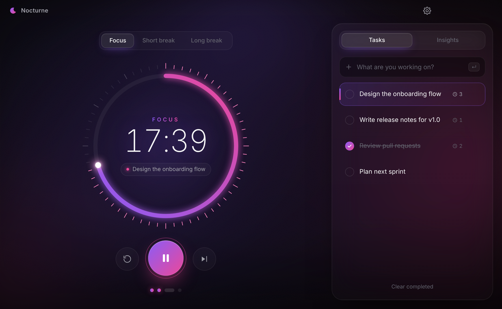
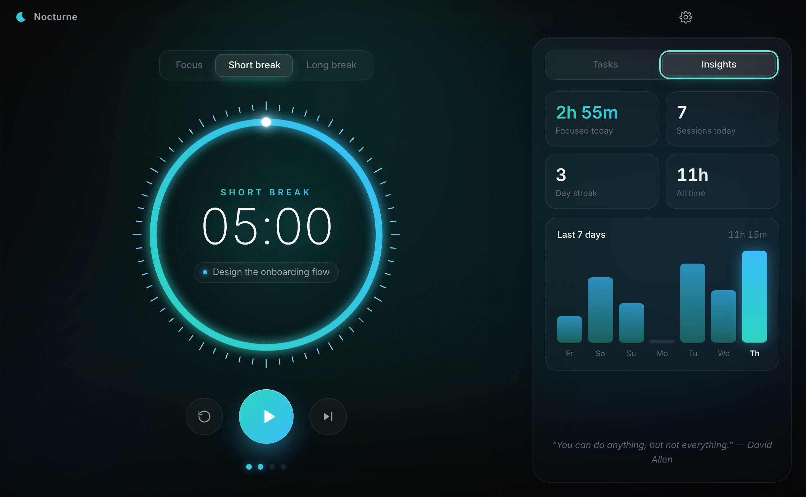
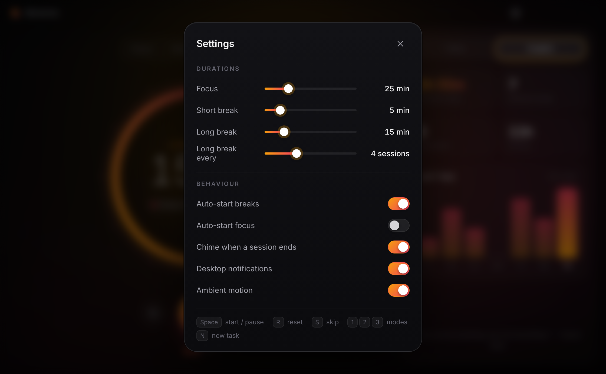

<p align="center">
  
</p>

<h1 align="center">Nocturne</h1>

<p align="center">
  A beautiful, distraction-free focus timer for <b>macOS</b> and <b>Windows</b>.<br/>
  Deep black, glowing, and calm.
</p>

<p align="center">
  <a href="../../releases/latest"><b>⬇ Download the latest release</b></a>
</p>

<p align="center">
  
</p>

## Features

- **Glowing focus ring**: a gradient progress dial with tick marks, a live knob and a breathing glow while you work.
- **Ambient aurora**: a slow, soft-moving background that shifts colour with each mode (violet for focus, teal for short breaks, amber for long breaks).
- **Pomodoro cycles**: focus, short break and long break, with optional auto-start and a configurable long-break interval.
- **Tasks**: add tasks, pick the one you're on, and Nocturne counts how many sessions each one took.
- **Insights**: time focused today, sessions, day streak, all-time total and a 7-day chart.
- **Gentle chime and desktop notifications** when a session ends, plus progress in the Windows taskbar and macOS dock.
- **Keyboard-first**: `Space` start/pause · `R` reset · `S` skip · `1` `2` `3` switch mode · `N` new task · `,` settings.
- Everything is stored locally on your machine. No accounts, no tracking.

<p align="center">
  
  
</p>

## Download

Grab the files from the [**Releases**](../../releases/latest) page:

| Platform | File |
| --- | --- |
| macOS (Apple Silicon and Intel) | `Nocturne-x.y.z-mac.dmg`: open it and drag Nocturne into Applications |
| macOS (zip) | `Nocturne-x.y.z-mac.zip`: unzip to get `Nocturne.app` |
| Windows installer | `Nocturne-Setup-x.y.z.exe` |
| Windows portable | `Nocturne-x.y.z-portable.exe`: no install needed |

**First launch on macOS:** the app isn't notarized by Apple, so right-click `Nocturne.app` → **Open** → **Open**.
On macOS 15 or later, open **System Settings → Privacy & Security** and click **Open Anyway**.

**First launch on Windows:** if SmartScreen shows a warning, click **More info → Run anyway**.

## Run from source

```bash
npm install
npm start
```

## Build installers yourself

```bash
npm run dist:mac   # on a Mac   → dist/*.dmg, dist/*.zip
npm run dist:win   # on Windows → dist/*.exe
```

## Automatic releases

Every push to `main` triggers [`.github/workflows/release.yml`](.github/workflows/release.yml). It builds the macOS app on a Mac runner and the Windows `.exe` files on a Windows runner, then publishes them to a GitHub Release tagged with the version in `package.json`.
To ship a new version, bump `"version"` in `package.json` and push.

## Tech

[Electron](https://www.electronjs.org/) with plain HTML, CSS and JavaScript (no frameworks), packaged with [electron-builder](https://www.electron.build/).

## License

MIT
